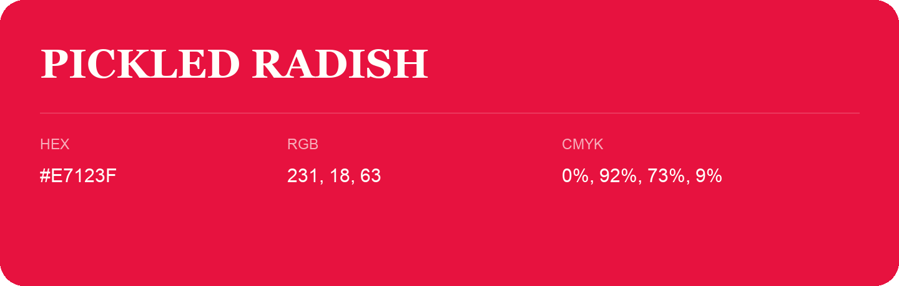

## Pickled Radish

- HEX: #E7123F
- RGB: 231, 18, 63
- CMYK: 0%, 92%, 73%, 9%
- Character: warm, expressive, energetic
- Suggested uses: food brands, expressive identities, promotional accents

- Source images: IMG_9075.JPG
