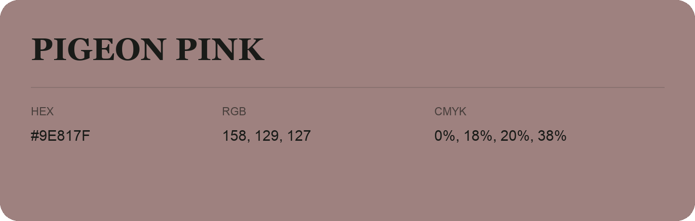

## Pigeon Pink

- HEX: #9E817F
- RGB: 158, 129, 127
- CMYK: 0%, 18%, 20%, 38%
- Character: warm, expressive, energetic
- Suggested uses: food brands, expressive identities, promotional accents

- Source images: iCloud Photos 2/IMG_9172.JPG
