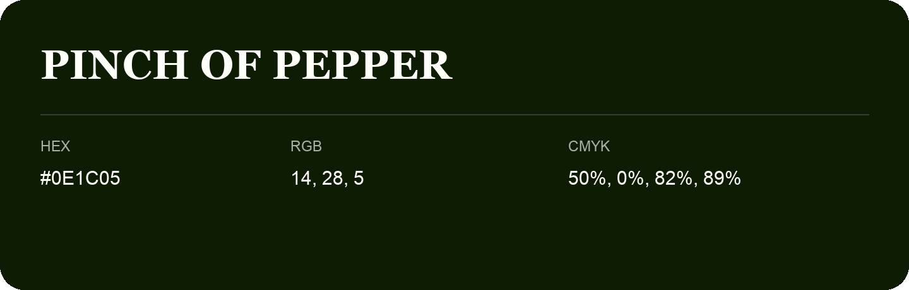

## Pinch Of Pepper

- HEX: #0E1C05
- RGB: 14, 28, 5
- CMYK: 50%, 0%, 82%, 89%
- Character: deep, grounded, understated
- Suggested uses: premium packaging, editorial typography, dark backgrounds

- Source images: iCloud Photos 2/IMG_9140.JPG

- Name note: Other distinct shades share this name: [pinch-of-pepper](pinch-of-pepper.md).
