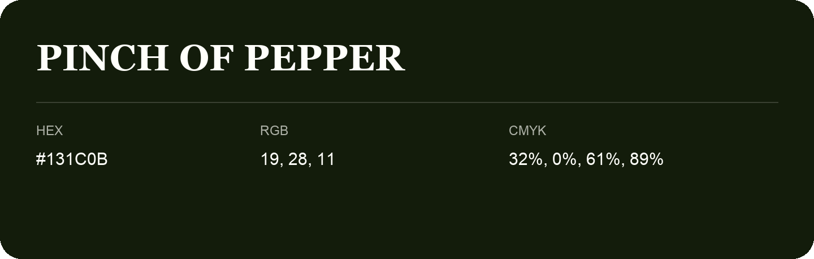

## Pinch Of Pepper

- HEX: #131C0B
- RGB: 19, 28, 11
- CMYK: 32%, 0%, 61%, 89%
- Character: natural, grounded, fresh
- Suggested uses: outdoor businesses, wellness brands, organic packaging

- Source images: IMG_9035.JPG

- Data provenance: HEX recovered from page data; cross-checked against the readable source RGB.

- Name note: Other distinct shades share this name: [pinch-of-pepper-0e1c05](pinch-of-pepper-0e1c05.md).
