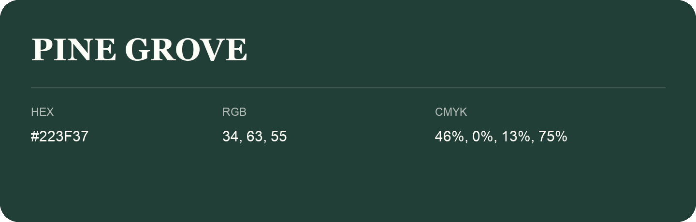

## Pine Grove

- HEX: #223F37
- RGB: 34, 63, 55
- CMYK: 46%, 0%, 13%, 75%
- Character: deep, grounded, understated
- Suggested uses: premium packaging, editorial typography, dark backgrounds

- Source images: IMG_9030.JPG

- Name note: Other distinct shades share this name: [pine-grove-253b38](pine-grove-253b38.md), [pine-grove-294038](pine-grove-294038.md).
