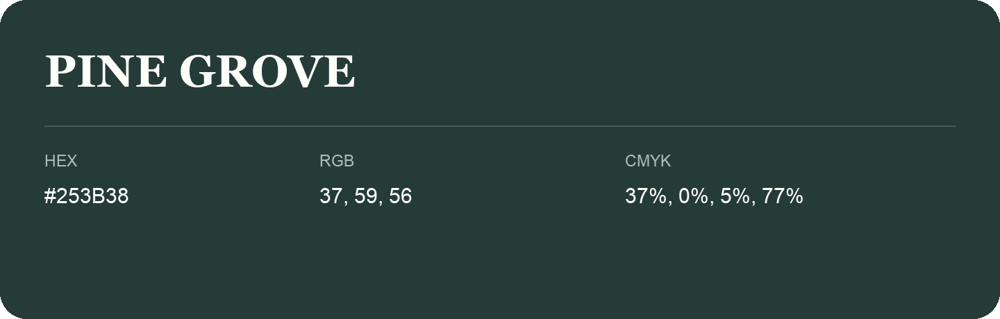

## Pine Grove

- HEX: #253B38
- RGB: 37, 59, 56
- CMYK: 37%, 0%, 5%, 77%
- Character: deep, grounded, understated
- Suggested uses: premium packaging, editorial typography, dark backgrounds

- Source images: IMG_9052.JPG

- Name note: Other distinct shades share this name: [pine-grove-223f37](pine-grove-223f37.md), [pine-grove-294038](pine-grove-294038.md).
