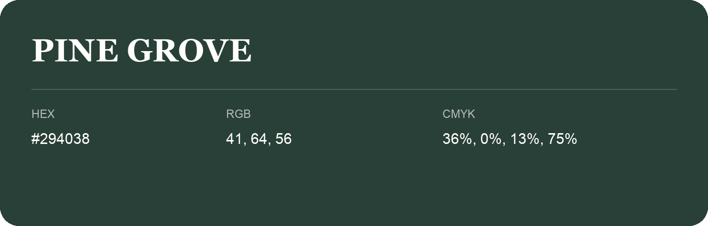

## Pine Grove

- HEX: #294038
- RGB: 41, 64, 56
- CMYK: 36%, 0%, 13%, 75%
- Character: deep, grounded, understated
- Suggested uses: premium packaging, editorial typography, dark backgrounds

- Source images: IMG_8994.JPG

- Name note: Other distinct shades share this name: [pine-grove-223f37](pine-grove-223f37.md), [pine-grove-253b38](pine-grove-253b38.md).
