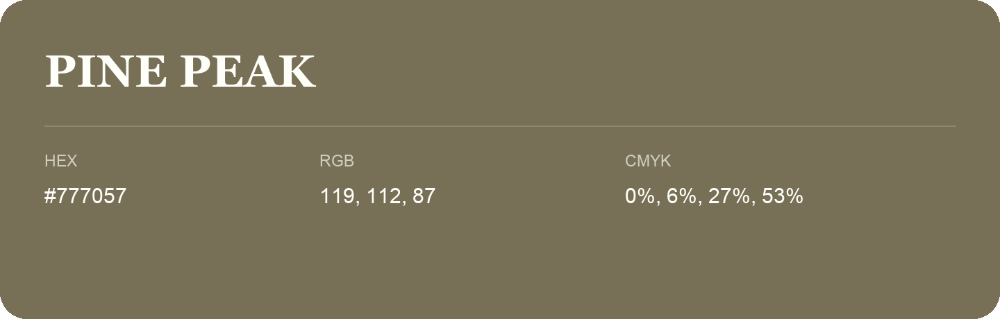

## Pine Peak

- HEX: #777057
- RGB: 119, 112, 87
- CMYK: 0%, 6%, 27%, 53%
- Character: sunny, lively, optimistic
- Suggested uses: friendly consumer brands, food packaging, cheerful accents

- Source images: IMG_9009.JPG
