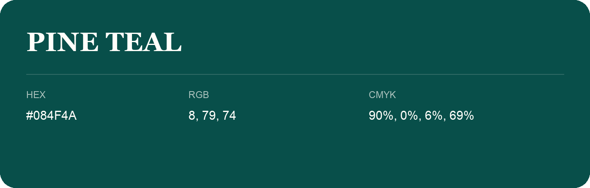

## Pine Teal

- HEX: #084F4A
- RGB: 8, 79, 74
- CMYK: 90%, 0%, 6%, 69%
- Character: deep, grounded, understated
- Suggested uses: premium packaging, editorial typography, dark backgrounds

- Source images: IMG_8985.JPG

- Name note: Other distinct shades share this name: [pine-teal-20473e](pine-teal-20473e.md).
