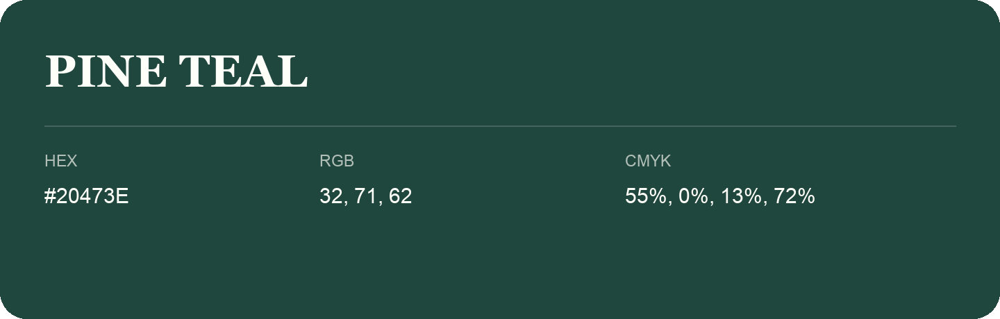

## Pine Teal

- HEX: #20473E
- RGB: 32, 71, 62
- CMYK: 55%, 0%, 13%, 72%
- Character: deep, grounded, understated
- Suggested uses: premium packaging, editorial typography, dark backgrounds

- Source images: IMG_8989.JPG

- Data provenance: RGB calculated from HEX, matching the page; source image RGB was unreadable.

- Name note: Other distinct shades share this name: [pine-teal-084f4a](pine-teal-084f4a.md).
