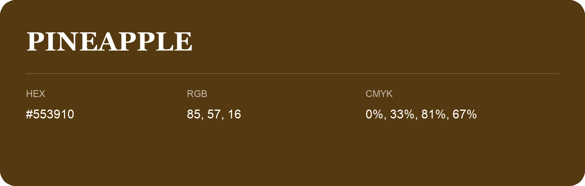

## Pineapple

- HEX: #553910
- RGB: 85, 57, 16
- CMYK: 0%, 33%, 81%, 67%
- Character: deep, grounded, understated
- Suggested uses: premium packaging, editorial typography, dark backgrounds

- Source images: iCloud Photos 2/IMG_9138.JPG
