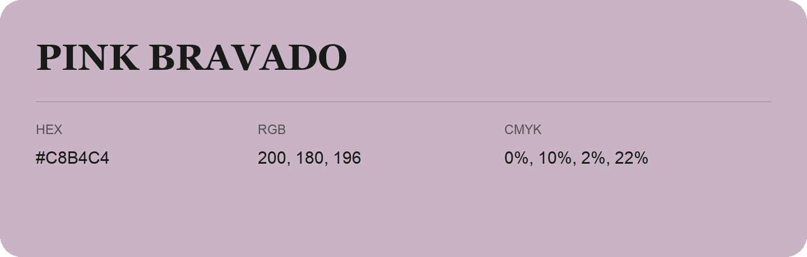

## Pink Bravado

- HEX: #C8B4C4
- RGB: 200, 180, 196
- CMYK: 0%, 10%, 2%, 22%
- Character: quiet, balanced, understated
- Suggested uses: professional services, minimal identities, supporting backgrounds

- Source images: IMG_9019.JPG
