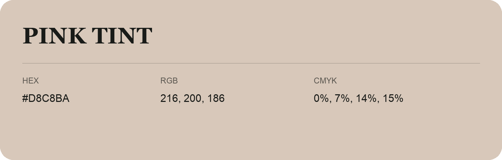

## Pink Tint

- HEX: #D8C8BA
- RGB: 216, 200, 186
- CMYK: 0%, 7%, 14%, 15%
- Character: soft, gentle, approachable
- Suggested uses: friendly consumer brands, gentle backgrounds, welcoming accents

- Source images: IMG_9074.JPG
