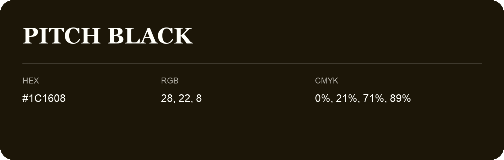

## Pitch Black

- HEX: #1C1608
- RGB: 28, 22, 8
- CMYK: 0%, 21%, 71%, 89%
- Character: earthy, rich, warm
- Suggested uses: premium packaging, rustic brands, dark backgrounds

- Source images: IMG_8987.JPG
