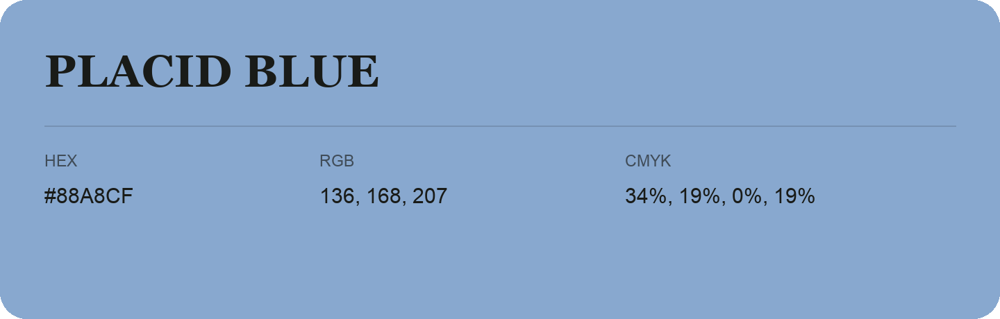

## Placid Blue

- HEX: #88A8CF
- RGB: 136, 168, 207
- CMYK: 34%, 19%, 0%, 19%
- Character: soft, gentle, approachable
- Suggested uses: friendly consumer brands, gentle backgrounds, welcoming accents

- Source images: iCloud Photos 2/IMG_9160.JPG
- Data provenance: RGB calculated from HEX; source text recognition was uncertain.
