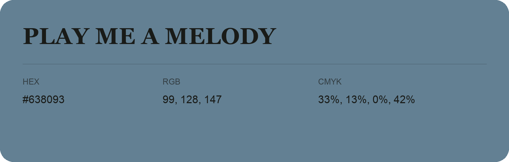

## Play Me a Melody

- HEX: #638093
- RGB: 99, 128, 147
- CMYK: 33%, 13%, 0%, 42%
- Character: cool, composed, dependable
- Suggested uses: professional services, technology brands, calm backgrounds

- Source images: IMG_9065.JPG
