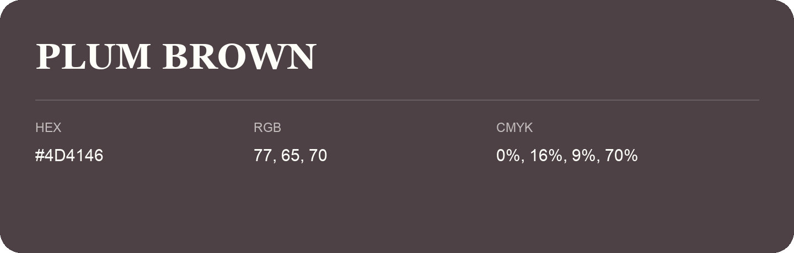

## Plum Brown

- HEX: #4D4146
- RGB: 77, 65, 70
- CMYK: 0%, 16%, 9%, 70%
- Character: expressive, imaginative, refined
- Suggested uses: beauty brands, creative businesses, distinctive accents

- Source images: IMG_9073.JPG
