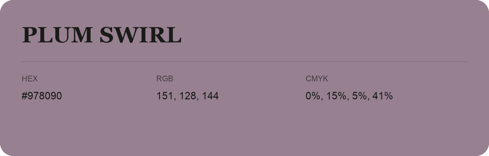

## Plum Swirl

- HEX: #978090
- RGB: 151, 128, 144
- CMYK: 0%, 15%, 5%, 41%
- Character: expressive, imaginative, refined
- Suggested uses: beauty brands, creative businesses, distinctive accents

- Source images: IMG_9019.JPG

- Data provenance: RGB calculated from HEX, matching the page; source image RGB was unreadable.
