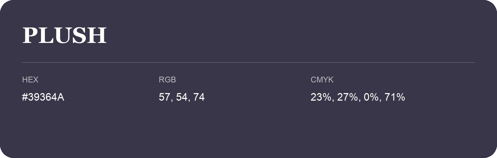

## Plush

- HEX: #39364A
- RGB: 57, 54, 74
- CMYK: 23%, 27%, 0%, 71%
- Character: cool, composed, dependable
- Suggested uses: professional services, technology brands, calm backgrounds

- Source images: IMG_9092.JPG
