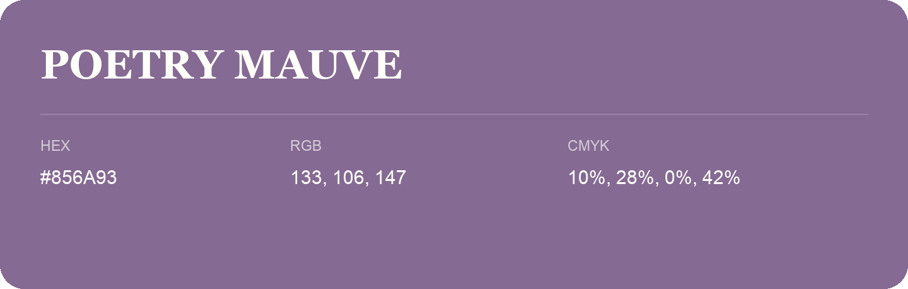

## Poetry Mauve

- HEX: #856A93
- RGB: 133, 106, 147
- CMYK: 10%, 28%, 0%, 42%
- Character: expressive, imaginative, refined
- Suggested uses: beauty brands, creative businesses, distinctive accents

- Source images: IMG_9033.JPG
