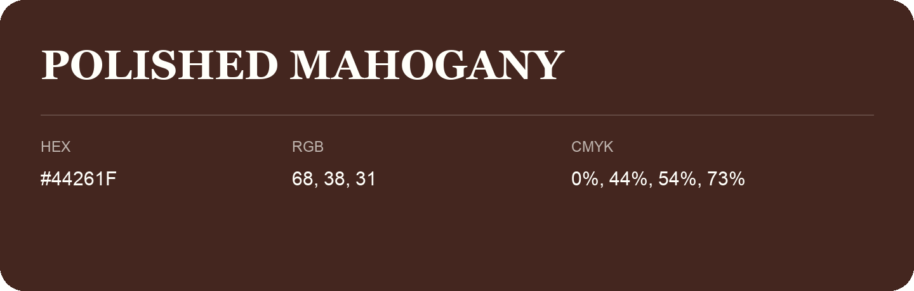

## Polished Mahogany

- HEX: #44261F
- RGB: 68, 38, 31
- CMYK: 0%, 44%, 54%, 73%
- Character: deep, grounded, understated
- Suggested uses: premium packaging, editorial typography, dark backgrounds

- Source images: IMG_9057.JPG

## Consolidated source variants

This is the canonical library entry. Same-name variants below are within ΔE00 ≤ 1 of this shade and were consolidated editorially. Their source values are preserved; they were not source errors.

### Source variant #462721

- HEX: #462721
- RGB: 70, 39, 33
- CMYK: 0%, 44%, 53%, 73%
- Difference from canonical: ΔE00 0.7835.
- Source images: iCloud Photos 2/IMG_9136.JPG

- Name note: Other distinct shades share this name: [polished-mahogany-442624](polished-mahogany-442624.md).
