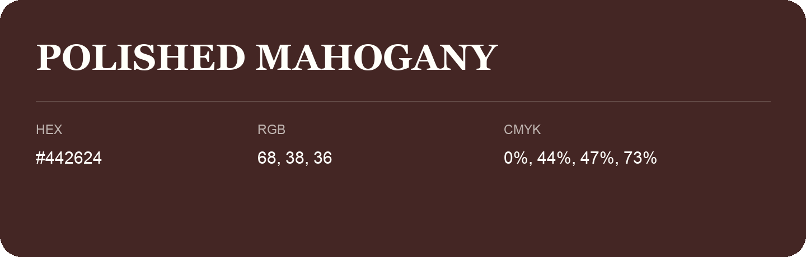

## Polished Mahogany

- HEX: #442624
- RGB: 68, 38, 36
- CMYK: 0%, 44%, 47%, 73%
- Character: deep, grounded, understated
- Suggested uses: premium packaging, editorial typography, dark backgrounds

- Source images: IMG_9084.JPG

- Name note: Other distinct shades share this name: [polished-mahogany-44261f](polished-mahogany-44261f.md).
