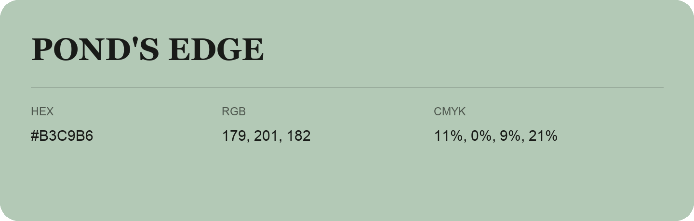

## Pond'S Edge

- HEX: #B3C9B6
- RGB: 179, 201, 182
- CMYK: 11%, 0%, 9%, 21%
- Character: quiet, balanced, understated
- Suggested uses: professional services, minimal identities, supporting backgrounds

- Source images: iCloud Photos 2/IMG_9159.JPG
