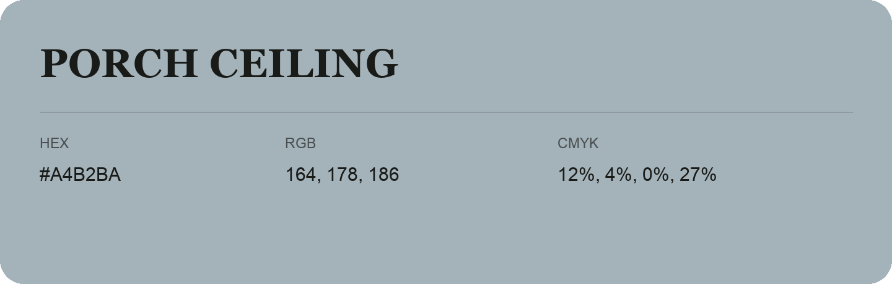

## Porch Ceiling

- HEX: #A4B2BA
- RGB: 164, 178, 186
- CMYK: 12%, 4%, 0%, 27%
- Character: quiet, balanced, understated
- Suggested uses: professional services, minimal identities, supporting backgrounds

- Source images: iCloud Photos 2/IMG_9163.JPG
- Data provenance: RGB calculated from HEX; source text recognition was uncertain.
