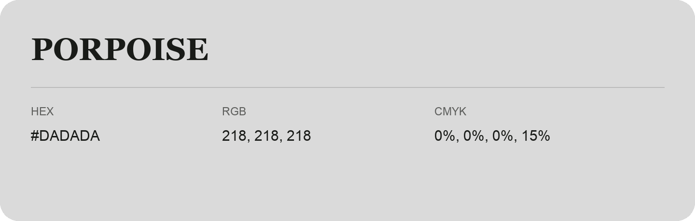

## Porpoise

- HEX: #DADADA
- RGB: 218, 218, 218
- CMYK: 0%, 0%, 0%, 15%
- Character: quiet, balanced, understated
- Suggested uses: professional services, minimal identities, supporting backgrounds

- Source images: IMG_9020.JPG

- Data provenance: HEX recovered from page data; cross-checked against the readable source RGB.

## Consolidated source variants

This is the canonical library entry. Same-name variants below are within ΔE00 ≤ 1 of this shade and were consolidated editorially. Their source values are preserved; they were not source errors.

### Source variant #DBDADA

- HEX: #DBDADA
- RGB: 219, 218, 218
- CMYK: 0%, 0%, 0%, 14%
- Difference from canonical: ΔE00 0.5188.
- Source images: IMG_9102.JPG
- Data provenance: HEX recovered from page data; cross-checked against the readable source RGB.

### Source variant #DADADB

- HEX: #DADADB
- RGB: 218, 218, 219
- CMYK: 0%, 0%, 0%, 14%
- Difference from canonical: ΔE00 0.5535.
- Source images: iCloud Photos 2/IMG_9179.JPG
