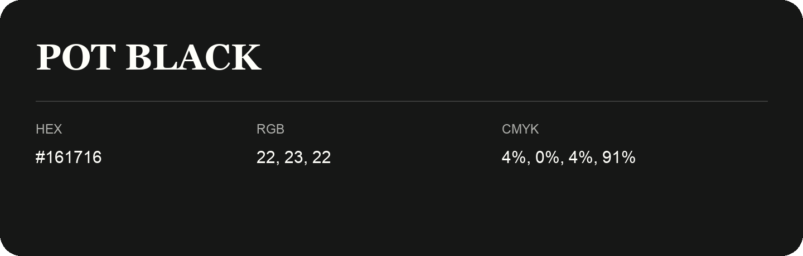

## Pot Black

- HEX: #161716
- RGB: 22, 23, 22
- CMYK: 4%, 0%, 4%, 91%
- Character: deep, grounded, understated
- Suggested uses: premium packaging, editorial typography, dark backgrounds

- Source images: IMG_9095.JPG

- Name note: Other distinct shades share this name: [pot-black-171615](pot-black-171615.md).
