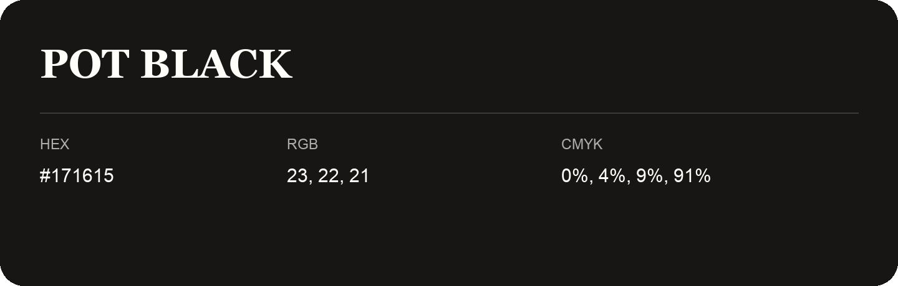

## Pot Black

- HEX: #171615
- RGB: 23, 22, 21
- CMYK: 0%, 4%, 9%, 91%
- Character: deep, grounded, understated
- Suggested uses: premium packaging, editorial typography, dark backgrounds

- Source images: IMG_9076.JPG

- Name note: Other distinct shades share this name: [pot-black-161716](pot-black-161716.md).
