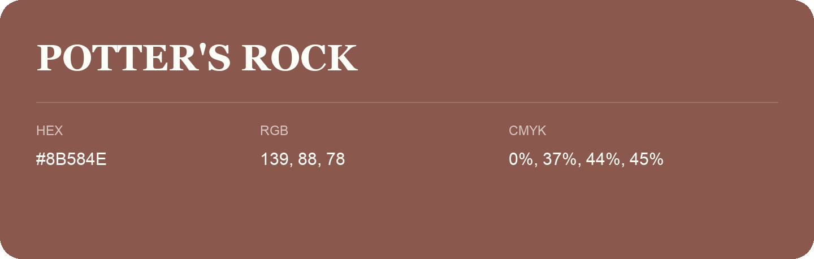

## Potter'S Rock

- HEX: #8B584E
- RGB: 139, 88, 78
- CMYK: 0%, 37%, 44%, 45%
- Character: warm, expressive, energetic
- Suggested uses: food brands, expressive identities, promotional accents

- Source images: iCloud Photos 2/IMG_9179.JPG
