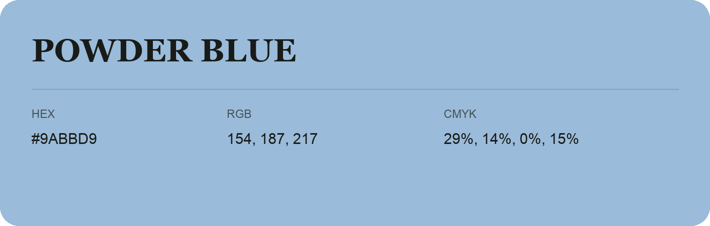

## Powder Blue

- HEX: #9ABBD9
- RGB: 154, 187, 217
- CMYK: 29%, 14%, 0%, 15%
- Character: soft, gentle, approachable
- Suggested uses: friendly consumer brands, gentle backgrounds, welcoming accents

- Source images: IMG_8990.JPG
