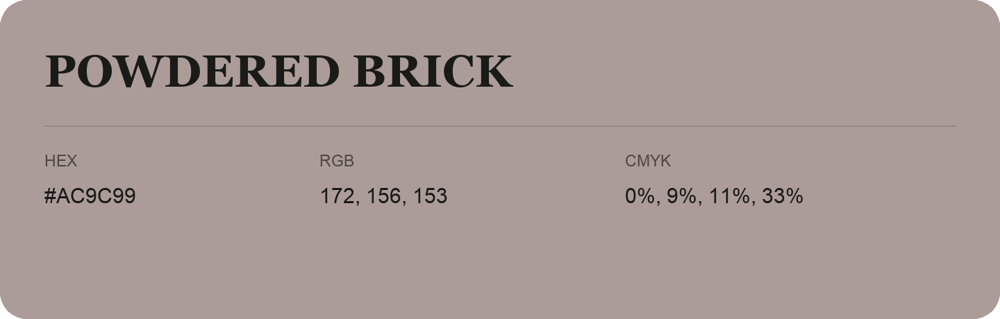

## Powdered Brick

- HEX: #AC9C99
- RGB: 172, 156, 153
- CMYK: 0%, 9%, 11%, 33%
- Character: quiet, balanced, understated
- Suggested uses: professional services, minimal identities, supporting backgrounds

- Source images: IMG_9013.JPG
