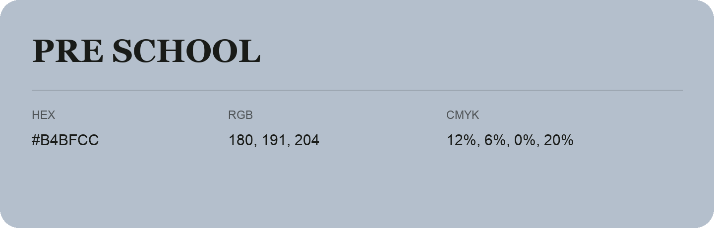

## Pre School

- HEX: #B4BFCC
- RGB: 180, 191, 204
- CMYK: 12%, 6%, 0%, 20%
- Character: quiet, balanced, understated
- Suggested uses: professional services, minimal identities, supporting backgrounds

- Source images: IMG_9072.JPG

- Data provenance: RGB calculated from HEX, matching the page; source image RGB was unreadable.
