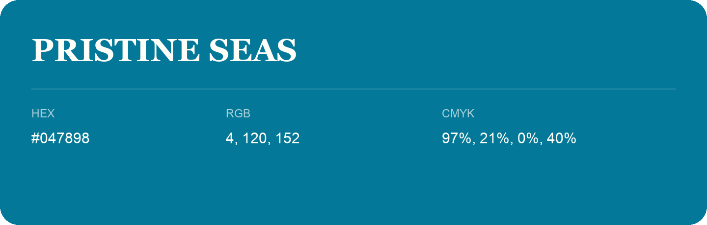

## Pristine Seas

- HEX: #047898
- RGB: 4, 120, 152
- CMYK: 97%, 21%, 0%, 40%
- Character: calm, fresh, composed
- Suggested uses: wellness brands, coastal hospitality, modern service brands

- Source images: iCloud Photos 2/IMG_9149.JPG
