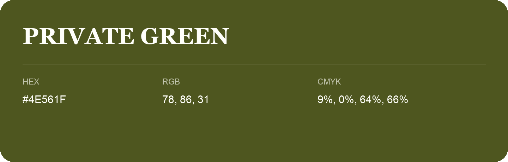

## Private Green

- HEX: #4E561F
- RGB: 78, 86, 31
- CMYK: 9%, 0%, 64%, 66%
- Character: sunny, lively, optimistic
- Suggested uses: friendly consumer brands, food packaging, cheerful accents

- Source images: IMG_9111.JPG
