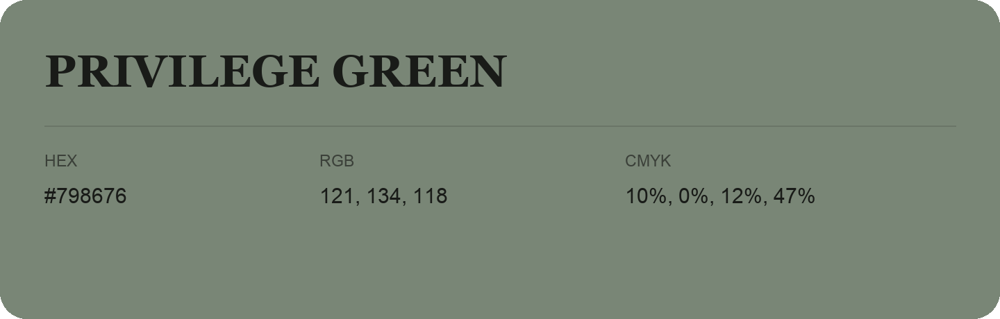

## Privilege Green

- HEX: #798676
- RGB: 121, 134, 118
- CMYK: 10%, 0%, 12%, 47%
- Character: quiet, balanced, understated
- Suggested uses: professional services, minimal identities, supporting backgrounds

- Source images: IMG_9021.JPG
