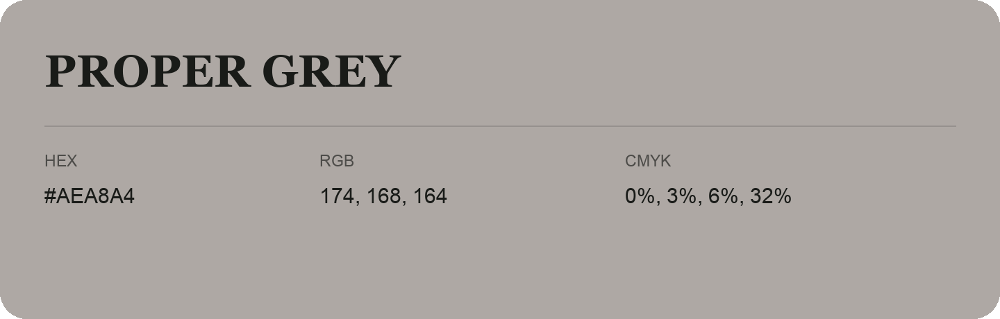

## Proper Grey

- HEX: #AEA8A4
- RGB: 174, 168, 164
- CMYK: 0%, 3%, 6%, 32%
- Character: quiet, balanced, understated
- Suggested uses: professional services, minimal identities, supporting backgrounds

- Source images: IMG_9016.JPG
