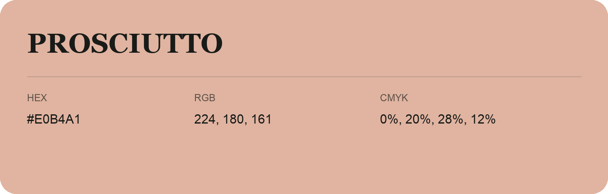

## Prosciutto

- HEX: #E0B4A1
- RGB: 224, 180, 161
- CMYK: 0%, 20%, 28%, 12%
- Character: soft, warm, playful
- Suggested uses: friendly consumer brands, gentle backgrounds, welcoming accents

- Source images: iCloud Photos 2/IMG_9123.JPG
