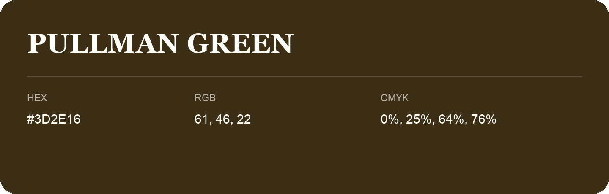

## Pullman Green

- HEX: #3D2E16
- RGB: 61, 46, 22
- CMYK: 0%, 25%, 64%, 76%
- Character: earthy, rich, warm
- Suggested uses: premium packaging, rustic brands, dark backgrounds

- Source images: IMG_9052.JPG
