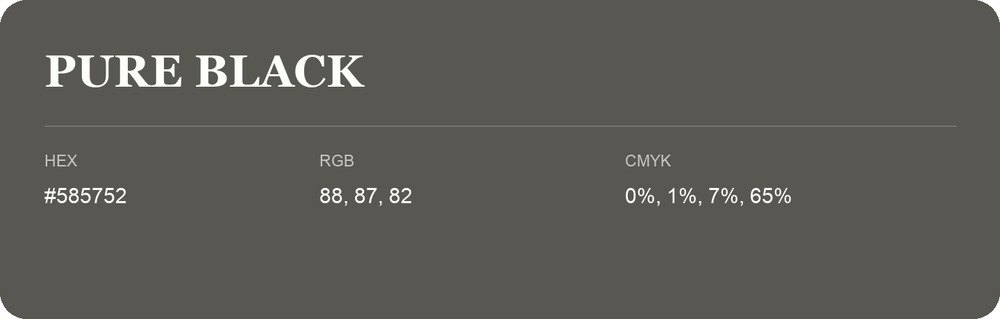

## Pure Black

- HEX: #585752
- RGB: 88, 87, 82
- CMYK: 0%, 1%, 7%, 65%
- Character: restrained, grounded, sophisticated
- Suggested uses: premium brands, editorial typography, dark backgrounds

- Source images: IMG_9027.JPG
