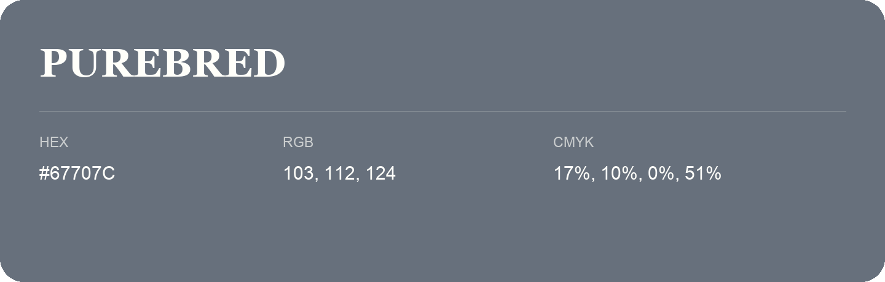

## Purebred

- HEX: #67707C
- RGB: 103, 112, 124
- CMYK: 17%, 10%, 0%, 51%
- Character: cool, composed, dependable
- Suggested uses: professional services, technology brands, calm backgrounds

- Source images: IMG_9118.JPG

- Data provenance: RGB calculated from HEX, matching the page; source image RGB was unreadable.
