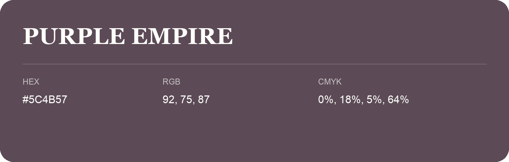

## Purple Empire

- HEX: #5C4B57
- RGB: 92, 75, 87
- CMYK: 0%, 18%, 5%, 64%
- Character: expressive, imaginative, refined
- Suggested uses: beauty brands, creative businesses, distinctive accents

- Source images: IMG_9019.JPG
