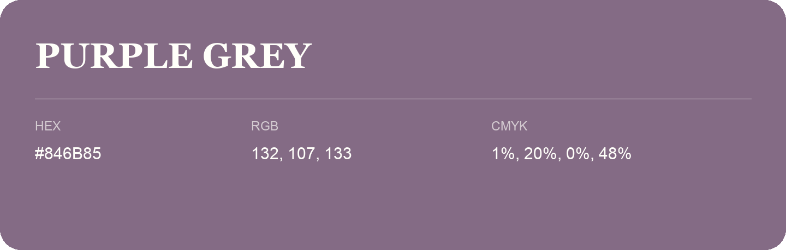

## Purple Grey

- HEX: #846B85
- RGB: 132, 107, 133
- CMYK: 1%, 20%, 0%, 48%
- Character: expressive, imaginative, refined
- Suggested uses: beauty brands, creative businesses, distinctive accents

- Source images: IMG_9025.JPG

## Consolidated source variants

This is the canonical library entry. Same-name variants below are within ΔE00 ≤ 1 of this shade and were consolidated editorially. Their source values are preserved; they were not source errors.

### Source variant #876C85

- HEX: #876C85
- RGB: 135, 108, 133
- CMYK: 0%, 20%, 1%, 47%
- Difference from canonical: ΔE00 0.9462.
- Source images: iCloud Photos 2/IMG_9171.JPG
