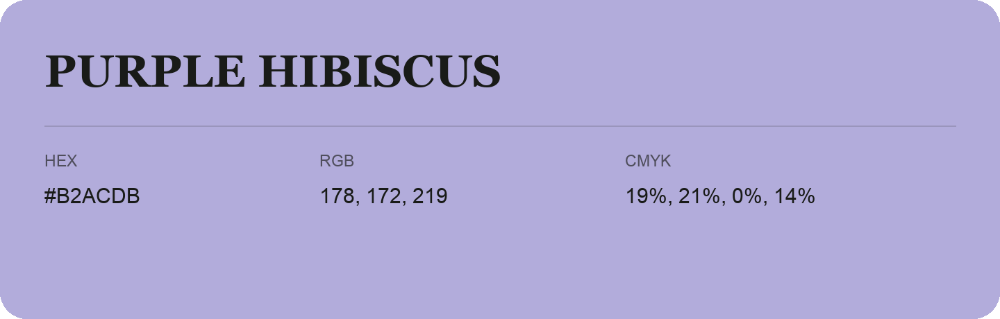

## Purple Hibiscus

- HEX: #B2ACDB
- RGB: 178, 172, 219
- CMYK: 19%, 21%, 0%, 14%
- Character: soft, gentle, approachable
- Suggested uses: friendly consumer brands, gentle backgrounds, welcoming accents

- Source images: IMG_9029.JPG
