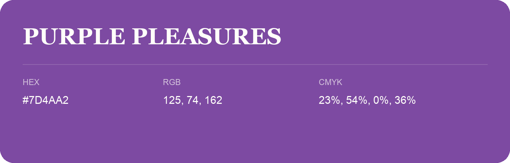

## Purple Pleasures

- HEX: #7D4AA2
- RGB: 125, 74, 162
- CMYK: 23%, 54%, 0%, 36%
- Character: expressive, imaginative, refined
- Suggested uses: beauty brands, creative businesses, distinctive accents

- Source images: iCloud Photos 2/IMG_9155.JPG
