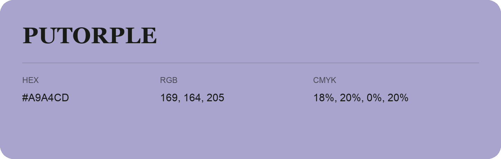

## Putorple

- HEX: #A9A4CD
- RGB: 169, 164, 205
- CMYK: 18%, 20%, 0%, 20%
- Character: soft, gentle, approachable
- Suggested uses: friendly consumer brands, gentle backgrounds, welcoming accents

- Source images: iCloud Photos 2/IMG_9155.JPG
- Data provenance: RGB calculated from HEX; source text recognition was uncertain.
