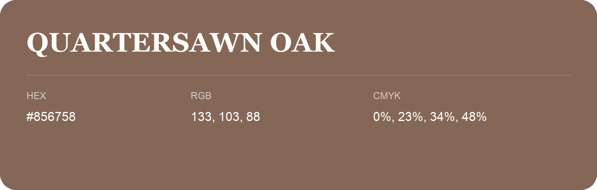

## Quartersawn Oak

- HEX: #856758
- RGB: 133, 103, 88
- CMYK: 0%, 23%, 34%, 48%
- Character: earthy, rich, warm
- Suggested uses: premium packaging, rustic brands, dark backgrounds

- Source images: IMG_9068.JPG

- Data provenance: RGB calculated from HEX, matching the page; source image RGB was unreadable.
