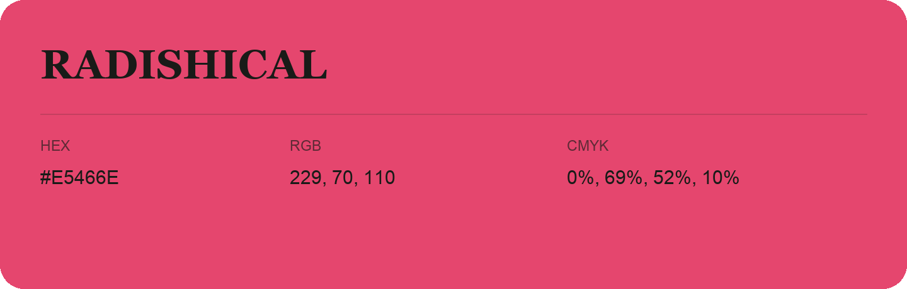

## Radishical

- HEX: #E5466E
- RGB: 229, 70, 110
- CMYK: 0%, 69%, 52%, 10%
- Character: expressive, imaginative, refined
- Suggested uses: beauty brands, creative businesses, distinctive accents

- Source images: IMG_9032.JPG
