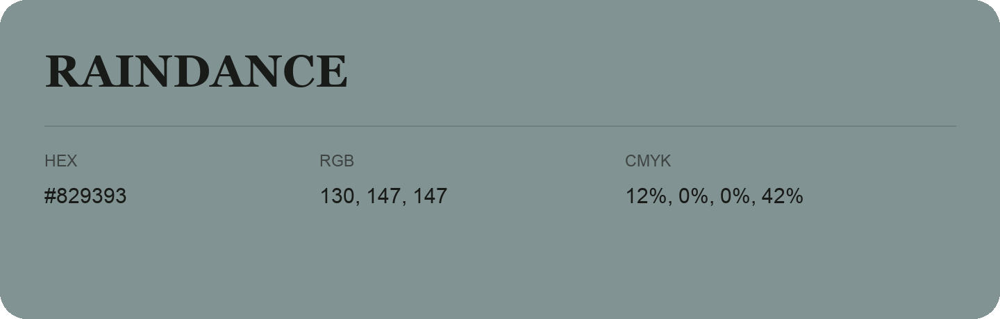

## Raindance

- HEX: #829393
- RGB: 130, 147, 147
- CMYK: 12%, 0%, 0%, 42%
- Character: quiet, balanced, understated
- Suggested uses: professional services, minimal identities, supporting backgrounds

- Source images: IMG_9060.JPG
