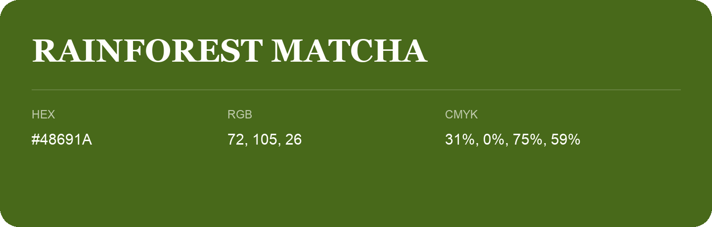

## Rainforest Matcha

- HEX: #48691A
- RGB: 72, 105, 26
- CMYK: 31%, 0%, 75%, 59%
- Character: natural, grounded, fresh
- Suggested uses: outdoor businesses, wellness brands, organic packaging

- Source images: IMG_9067.JPG
