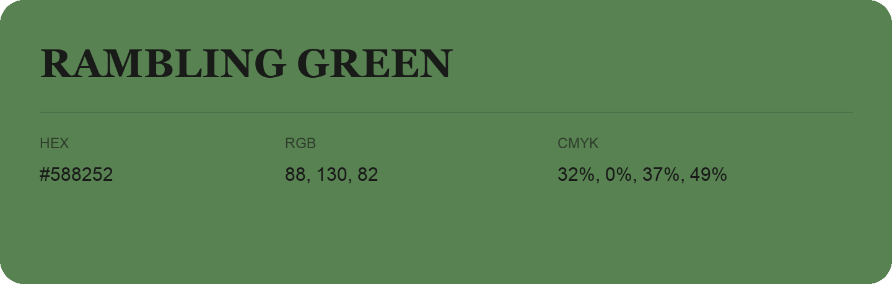

## Rambling Green

- HEX: #588252
- RGB: 88, 130, 82
- CMYK: 32%, 0%, 37%, 49%
- Character: natural, grounded, fresh
- Suggested uses: outdoor businesses, wellness brands, organic packaging

- Source images: IMG_9109.JPG
