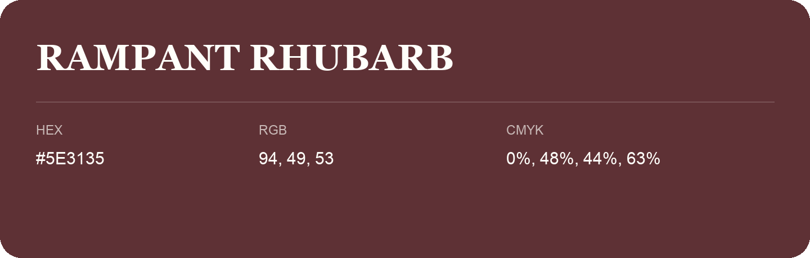

## Rampant Rhubarb

- HEX: #5E3135
- RGB: 94, 49, 53
- CMYK: 0%, 48%, 44%, 63%
- Character: deep, grounded, understated
- Suggested uses: premium packaging, editorial typography, dark backgrounds

- Source images: iCloud Photos 2/IMG_9122.JPG
